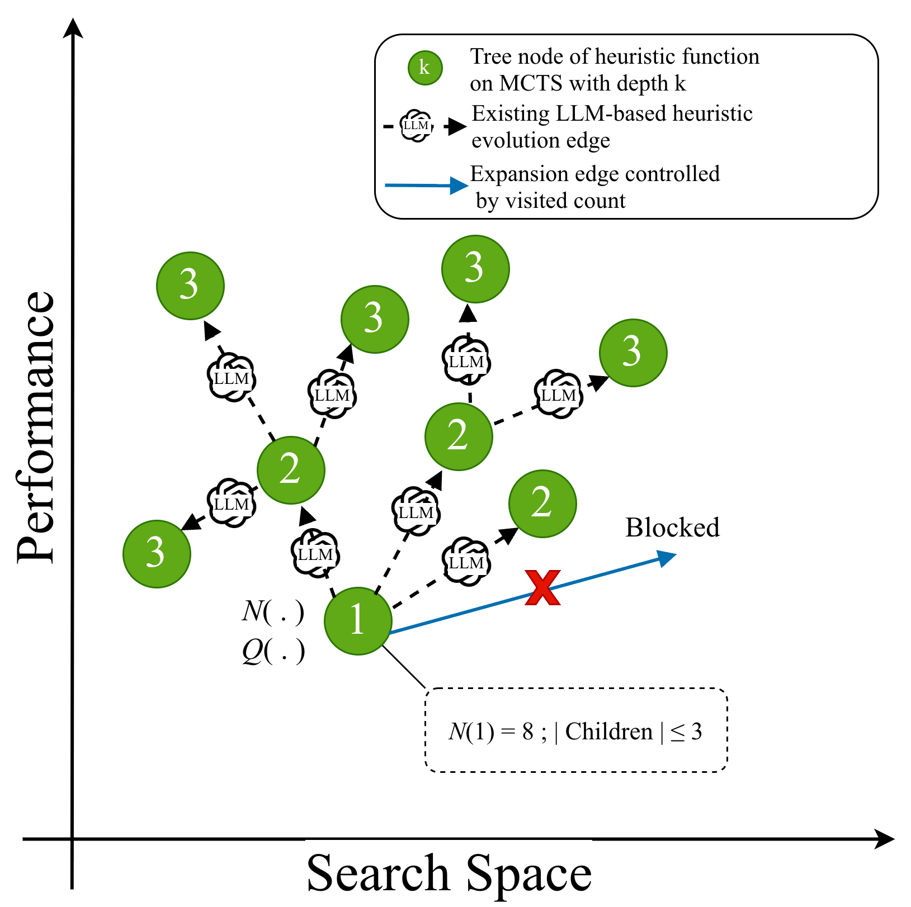
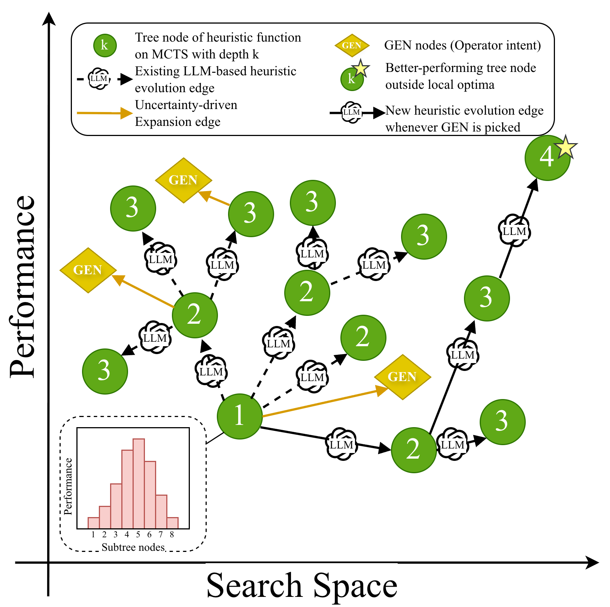

<div align="center">

# GENESIS

### Generative Exploration via Stochastic Inference in Monte Carlo Tree Search for Automatic Heuristic Design

**ML × OR Workshop @ NeurIPS 2026**

</div>

GENESIS is an uncertainty-aware Monte Carlo Tree Search framework for **LLM-based automatic heuristic design (AHD)**. An LLM writes heuristic functions for NP-hard combinatorial optimization problems (TSP, CVRP, knapsack, bin packing, ...). The performance of these heuristics behaves like samples from a high-variance stochastic process. GENESIS models this noise with Bayesian beliefs instead of averaging it away. This keeps the search from over-committing to fragile candidates and helps it surface robust ones.

- **Bayesian MCTS.** Every node carries a Normal–Inverse–Gamma (NIG) posterior over the meta-objective of its subtree. Operator nodes share a global NIG hyper-posterior.
- **Hierarchical Thompson sampling.** The search decides both *where* to expand and *which operator* to apply by sampling from local and global posteriors.
- **Assumption-Guided Reflective Expansion (AGRE).** After each expansion, the best new heuristic is critiqued at the level of its *assumptions* and refined.

<p align="center">
  
  &nbsp;&nbsp;
  
</p>
<p align="center"><em>(a) Progressive widening (MCTS-AHD) limits branching through a visit-count quota. (b) GENESIS adds GEN (operator) nodes and branches adaptively through hierarchical Thompson sampling.</em></p>

## How it works

The search tree contains two kinds of nodes:

| Node | Meaning | Posterior |
|---|---|---|
| **Real node** | A concrete heuristic with an observed meta-objective | Local NIG, updated by every heuristic in its subtree |
| **Operator (GEN) node** | "Expand the parent with operator *o*", one per operator per real node | Local NIG, shrunk toward the shared global hyper-posterior |

One iteration works as follows:

1. **Selection.** Start at the root. At each node, draw a value from the posterior of every real child and every operator child, then take the lowest. Choosing a real child descends the tree. Choosing an operator node stops the descent.
2. **Expansion.** Apply the chosen operator to the selected heuristic and generate *N* children.
3. **AGRE.** Refine the best child through a six-stage reflection: error signal → counterfactual failure → role-based conflict (defender / attacker / observer) → strategic abstraction → assumption repair → refinement guidance.
4. **Backpropagation.** Evaluate every new heuristic. Update the posteriors along the path to the root, and the global hyper-posterior.

The operators are as follows (code name in brackets):

| Operator | Description |
|---|---|
| **E2** (`e2`) | Idea-guided recombination of the selected heuristic with another elite one |
| **M1** (`m1`) | Structural modification: new mechanisms, equations or program parts |
| **M2** (`m2`) | Parameter variation of the selected heuristic |
| **S1** (`s1`) | Synthesis of the heuristics on the path from the root |
| **NS** (`counter`) | Novelty search: find the weaknesses of a heuristic and exploit them |
| **E1** (`e1`) | Diversity-driven generation (used for initialization) |

## Installation

```bash
git clone https://github.com/vgnam/GENESIS.git
cd GENESIS
pip install -r requirements.txt
```

The code was developed with Python 3.11.

## Quick start

GENESIS calls LLMs through [LiteLLM](https://docs.litellm.ai/docs/providers), so any provider LiteLLM supports will work. The paper uses `codestral-2508` through the Mistral API:

```bash
export MISTRAL_API_KEY=...            # Windows PowerShell: $env:MISTRAL_API_KEY="..."

python main.py problem=tsp_aco                  # TSP, ACO framework (default)
python main.py problem=cvrp_aco
python main.py problem=kp_constructive max_fe=1000
```

To use another LLM, set the `model` option and the matching API key, for example:

```bash
python main.py model=openai/gpt-4o-mini                     # OPENAI_API_KEY
python main.py model=openrouter/mistralai/codestral-2508    # OPENROUTER_API_KEY
```

A run writes its files to `outputs/<problem>-<type>/<timestamp>/`:

- `population_generation_<k>.json`: the elite population after *k* evaluations.
- `best_population_generation_<k>.json`: the best heuristic so far.
- `best_code_overall_val_stdout.txt`: validation results for the final best heuristic.
- `main.log`: the full log.

> [!NOTE]
> During the search, each candidate is written to `problems/<problem>/gpt.py` and evaluated there. At the end of a run, that file holds the best heuristic found.

## Problems

| Config (`problem=`) | Problem | Framework | Objective |
|---|---|---|---|
| `tsp_aco` | Traveling Salesman | Ant Colony Optimization | min tour length |
| `cvrp_aco` | Capacitated Vehicle Routing | Ant Colony Optimization | min total distance |
| `mkp_aco` | Multiple Knapsack | Ant Colony Optimization | max prize |
| `bpp_offline_aco` | Offline Bin Packing | Ant Colony Optimization | min #bins |
| `op_aco` | Orienteering | Ant Colony Optimization | max prize |
| `tsp_constructive` | Traveling Salesman | Step-by-step construction | min tour length |
| `kp_constructive` | 0-1 Knapsack | Step-by-step construction | max value |
| `asp_constructive` | Admissible Sets | Step-by-step construction | max set size |
| `tsp_gls` | Traveling Salesman | Guided Local Search | min tour length |
| `bpp_online` | Online Bin Packing | Priority function | min #bins |
| `*_aco_black_box` | TSP / CVRP / MKP / BPP with the problem description hidden | Ant Colony Optimization | as above |

Each problem lives in `problems/<name>/`. Training and validation datasets are generated automatically on first use where needed.

To evaluate the current `gpt.py` on the test sets:

```bash
python problems/tsp_aco/eval-test.py
python problems/kp_constructive/eval-test.py
```

To add a new problem, follow the existing ones:

- `cfg/problem/<name>.yaml`: description, objective type and training size.
- `prompts/<name>/`: `func_signature.txt`, `func_desc.txt` and `seed_func.txt`.
- `problems/<name>/eval.py`: called as `eval.py <size> <root_dir> train|val`. It must print the objective as its last line.

## Configuration

All options live in [`cfg/config.yaml`](cfg/config.yaml) and can be overridden on the command line:

| Option | Default | Description |
|---|---|---|
| `model` | `mistral/codestral-2508` | LiteLLM model string |
| `max_fe` | 500 | Evaluation budget (paper: 500 for ACO, 1,000 for constructive problems) |
| `init_pop_size` | 5 | Number of initial heuristics *N₀* |
| `n_children` | 3 | Heuristics generated per expansion, plus one refined by AGRE (*N* = 4) |
| `pop_size` | 30 | Size of the elite population used as operator context |
| `max_depth` | 10 | Maximum tree depth |
| `timeout` | 60 | Seconds allowed to evaluate one heuristic |

### Ablations

The ablation variants from the paper are available as switches:

```bash
python main.py ablation.posterior_sampling=false     # w/o posterior sampling (UCB on posterior means)
python main.py ablation.adaptive_op_selection=false  # w/o adaptive operator selection (uniform operator)
python main.py ablation.global_sharing=false         # w/o global information sharing
python main.py ablation.agre=false                   # w/o AGRE
python main.py ablation.agre_stages.counterfactual=false   # w/o CF  (also: role_conflict, abstraction, assumption_repair)
```

## Results

The tables below report average objective ± standard deviation over 3 runs with `codestral-2508`. The best result in each row is in bold.

<details open>
<summary><b>Ant Colony Optimization</b> (64 test instances per size; ↓ lower is better, ↑ higher is better)</summary>

| Problem | Size | EoH | ReEvo | HSEvo | MCTS-AHD | **GENESIS** |
|---|---|---|---|---|---|---|
| TSP ↓ | 20 | 3.867 ± 0.002 | 3.878 ± 0.010 | 3.874 ± 0.011 | 3.878 ± 0.010 | **3.866 ± 0.003** |
| | 50 | 5.860 ± 0.013 | 5.862 ± 0.003 | 5.871 ± 0.022 | 5.862 ± 0.003 | **5.807 ± 0.076** |
| | 100 | 8.453 ± 0.028 | 8.442 ± 0.079 | 8.388 ± 0.029 | 8.442 ± 0.079 | **8.385 ± 0.133** |
| CVRP ↓ | 20 | 4.919 ± 0.056 | 5.013 ± 0.185 | 4.931 ± 0.193 | 4.959 ± 0.079 | **4.842 ± 0.032** |
| | 50 | 9.588 ± 0.163 | 9.595 ± 0.311 | 9.629 ± 0.247 | 9.503 ± 0.063 | **9.004 ± 0.347** |
| | 100 | 17.039 ± 0.476 | 16.503 ± 0.992 | 16.868 ± 0.426 | 16.544 ± 0.170 | **15.827 ± 0.244** |
| MKP ↑ | 100 | 16.850 ± 0.158 | 17.013 ± 0.034 | 16.945 ± 0.065 | **17.066 ± 0.017** | 17.048 ± 0.037 |
| | 300 | 51.936 ± 0.768 | 53.556 ± 0.662 | 46.793 ± 8.028 | 53.222 ± 1.308 | **53.993 ± 0.191** |
| | 500 | 124.067 ± 1.383 | 130.687 ± 1.771 | 128.331 ± 3.399 | 129.781 ± 1.099 | **131.044 ± 0.948** |
| BPP ↓ | 120 | 49.531 ± 0.095 | 49.828 ± 0.053 | 49.661 ± 0.307 | 49.682 ± 0.180 | **49.453 ± 0.041** |
| | 500 | 205.115 ± 0.070 | 206.505 ± 0.503 | 205.474 ± 0.609 | 205.177 ± 0.095 | **204.865 ± 0.048** |
| | 1000 | 409.208 ± 0.079 | 412.182 ± 1.340 | 410.271 ± 1.220 | 408.984 ± 0.688 | **408.719 ± 0.016** |

</details>

<details open>
<summary><b>Step-by-step construction</b> (TSP: tour length; KP: optimality gap in %; ASP: set size for (n, w))</summary>

| Problem | Size | EoH | ReEvo | HSEvo | MCTS-AHD | **GENESIS** |
|---|---|---|---|---|---|---|
| TSP ↓ | 20 | 4.163 ± 0.101 | 4.073 ± 0.022 | 4.049 ± 0.027 | 4.056 ± 0.018 | **4.030 ± 0.016** |
| | 50 | 6.649 ± 0.259 | 6.367 ± 0.018 | 6.329 ± 0.033 | 6.635 ± 0.718 | **6.304 ± 0.054** |
| | 100 | 9.258 ± 0.472 | 8.697 ± 0.032 | 8.654 ± 0.020 | 8.671 ± 0.026 | **8.623 ± 0.126** |
| | 200 | 13.116 ± 0.684 | 12.231 ± 0.030 | 12.165 ± 0.093 | 12.145 ± 0.050 | **12.040 ± 0.182** |
| KP ↓ | 100 | 0.080 ± 0.017 | 0.091 ± 0.003 | 0.074 ± 0.009 | 0.092 ± 0.005 | **0.073 ± 0.007** |
| | 200 | **0.082 ± 0.013** | 0.105 ± 0.002 | 0.089 ± 0.006 | 0.104 ± 0.002 | 0.084 ± 0.015 |
| | 500 | 0.057 ± 0.014 | 0.058 ± 0.011 | 0.062 ± 0.012 | 0.089 ± 0.027 | **0.051 ± 0.015** |
| | 1000 | 0.053 ± 0.031 | 0.044 ± 0.013 | 0.044 ± 0.014 | 0.088 ± 0.038 | **0.037 ± 0.012** |
| ASP ↑ | (12,7) | 783.00 ± 15.59 | 783.00 ± 15.59 | **792.00 ± 0.00** | **792.00 ± 0.00** | **792.00 ± 0.00** |
| | (15,10) | 12300.33 ± 2014.45 | 10230.00 ± 2195.75 | 9945.33 ± 3972.60 | 12082.33 ± 940.79 | **13559.67 ± 393.56** |
| | (21,15) | 26501.67 ± 4047.10 | 21678.00 ± 4388.37 | 20018.33 ± 6985.57 | 23679.67 ± 6718.00 | **32211.67 ± 893.39** |
| | (24,17) | 119749.00 ± 26711.08 | 92756.00 ± 23062.51 | 84125.00 ± 33275.70 | 95989.00 ± 25072.55 | **152286.00 ± 15091.02** |

</details>

## Repository structure

```
GENESIS/
├── main.py                 # entry point (Hydra)
├── cfg/
│   ├── config.yaml         # search, LLM and ablation settings
│   └── problem/            # one config per problem
├── genesis/
│   ├── search.py           # main loop: initialization, expansion, AGRE, logging
│   ├── tree.py             # Bayesian MCTS: NIG posteriors, global hyper-prior, hierarchical TS
│   ├── operators.py        # LLM prompts for E1/E2/M1/M2/S1/NS and the AGRE pipeline
│   ├── interface.py        # parent selection, retries, evaluation of generated code
│   ├── population.py       # elite population management
│   ├── problem.py          # prompt templates and sandboxed evaluation
│   └── llm.py              # LiteLLM client
├── prompts/                # function signature, description and seed heuristic per problem
├── problems/               # evaluators, solvers (ACO / GLS / construction) and datasets
└── utils/                  # helpers shared with the problem evaluators
```

## Acknowledgements

This codebase builds on [MCTS-AHD](https://github.com/zz1358m/MCTS-AHD-master) (Zheng et al., ICML 2025). Its problem suites and evaluators come from [EoH](https://github.com/FeiLiu36/EoH) and [ReEvo](https://github.com/ai4co/reevo). The adaptive-branching tree search is inspired by [AB-MCTS](https://arxiv.org/abs/2503.04412) (Inoue et al., 2025). We thank the authors for releasing their code.

## Citation

```bibtex
@inproceedings{genesis2026,
  title     = {Generative Exploration via Stochastic Inference in Monte Carlo Tree Search for Automatic Heuristic Design},
  author    = {TODO},
  booktitle = {NeurIPS 2026 Workshop on Machine Learning and Operations Research (ML{\texttimes}OR)},
  year      = {2026}
}
```

## License

Released under the [MIT License](LICENSE). Parts derived from MCTS-AHD keep their original MIT copyright notice. `problems/bpp_online` is under its own Apache-2.0 license.
